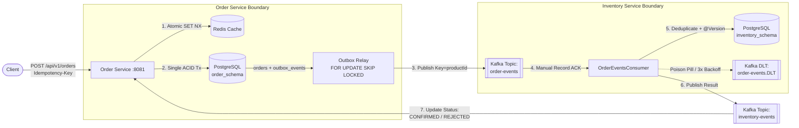

# Distributed Order Processing & Inventory System


An event-driven microservices platform built with **Java 21** and **Spring Boot 3** demonstrating production-grade reliability patterns for distributed transactions, eventual consistency, and high-concurrency inventory control without distributed two-phase commits (2PC).

---

## System Architecture



---

## Core Reliability Patterns Implemented

### 1. Defense-in-Depth Idempotency (Redis + PostgreSQL)
- **Fast Shield (Redis):** Incoming `POST /api/v1/orders` requests require an `Idempotency-Key` header. `IdempotencyService` executes an atomic `SET NX` in Redis to reject concurrent duplicate requests (`409 Conflict` while in-flight) and serve cached responses (`200 OK`) for completed retries.
- **Source of Truth Fallback (PostgreSQL):** A `UNIQUE` constraint on `order_schema.orders(idempotency_key)` guarantees zero duplicate orders even if Redis experiences an eviction or node crash.

### 2. Transactional Outbox Pattern (`FOR UPDATE SKIP LOCKED`)
- Writing to PostgreSQL and publishing to Kafka are not atomic across network boundaries. To eliminate dual-write inconsistencies, `OrderService` persists the `Order` and an `OutboxEvent` inside a single local `@Transactional` boundary.
- A background `OutboxRelay` polls `PENDING` rows using PostgreSQL's `FOR UPDATE SKIP LOCKED` (preventing worker lock contention) and publishes events with `enable.idempotence=true` and `acks=all`.

### 3. Idempotent Consumer & Optimistic Locking
- **At-Least-Once Deduplication:** Because Kafka guarantees at-least-once delivery, `InventoryService` records every `eventId` in `inventory_schema.processed_events` inside the same database transaction as the stock deduction. Duplicate deliveries hit the primary key check and are safely acknowledged without double-deducting stock.
- **Concurrency Control (`@Version`):** `ProductInventory` uses JPA `@Version` optimistic locking wrapped in a transaction-isolated retry coordinator (`InventoryReservationCoordinator`) to prevent lost updates and negative inventory under concurrent reservations.

### 4. Fault Tolerance & Dead Letter Topic (DLT)
- `KafkaErrorHandlingConfig` configures a `DefaultErrorHandler` with Exponential Backoff (`1s -> 2s -> 4s`, max 3 retries) for transient database failures.
- Non-retryable poison pills (`DeserializationException`, `IllegalArgumentException`) bypass retries and route directly to `order-events.DLT` with diagnostic headers, preventing partition head-of-line blocking.

### 5. Schema-per-Service & Contract Decoupling
- Both services share a PostgreSQL instance locally via strictly isolated schemas (`order_schema`, `inventory_schema`) managed independently by Flyway.
- Kafka consumers disable Java type headers (`spring.json.use.type.headers=false`) and deserialize directly into service-local Java 21 record contracts, eliminating package-level coupling.

---

## Architectural Trade-Offs & High-Scale Evolution

### 1. Outbox Polling (`SKIP LOCKED`) vs. Log-Based CDC (Debezium)

| Dimension | Current: Polling Relay (`SKIP LOCKED`) | Alternative: Debezium (PostgreSQL WAL) |
| :--- | :--- | :--- |
| **Operational Footprint** | Zero extra infrastructure; runs inside `order-service`. | Requires Kafka Connect cluster + Debezium connectors. |
| **Latency & DB Load** | Sub-second polling interval introduces minor read overhead. | Sub-10ms latency by tailing PostgreSQL Write-Ahead Log directly. |
| **Ordering Guarantee** | Multi-instance pollers can race on network publish order. | Strict commit-order preservation from WAL sequence. |

### 2. Multi-Instance Outbox Ordering: ShedLock vs. Hash Partitioning
- **Trade-off:** Running multiple `order-service` replicas with `SKIP LOCKED` scales polling throughput, but concurrent workers can publish events for the same `productId` out of commit order before reaching Kafka.
- **Mitigation Path:** For strict per-key ordering without CDC, enforce a single active poller via distributed locking (ShedLock) or partition polling queries by `hashtext(aggregate_id) % worker_count`.

### 3. Scaling Beyond 20,000 RPS on a Single "Hot" SKU (Flash Sale Bottleneck)
Partitioning Kafka by `productId` and using row-level `@Version` locking works cleanly for balanced traffic, but an extreme flash sale (e.g., 20,000 RPS on one `productId`) creates two bottlenecks: **Kafka Hot Partition** (single consumer thread saturation) and **DB Optimistic Lock Thrashing** (retry storms).

- **Approach A — Inventory Sharding (DB Bucketing):** Split a single SKU's stock across $N$ sub-rows `(product_id, bucket_id)` and route Kafka messages via `productId + "-" + randomBucket`. Reduces row lock contention by $1/N$, at the cost of scatter-gather complexity when aggregating fragmented tail inventory.
- **Approach B — Redis Lua Gatekeeper with Tombstone Fencing:**
  - Execute an atomic Redis Lua Script to decrement stock (`DECRBY`) and record a time-bounded lease in a Redis ZSET (`reservations:<productId>`), rejecting excess requests in `<1ms` before touching Kafka or PostgreSQL.
  - To prevent race conditions between a slow/GC-paused app node and a background expiration sweeper, the sweeper writes an `EXPIRED_RESERVATION` tombstone row into PostgreSQL (`ON CONFLICT (idempotency_key) DO NOTHING`) before returning stock to Redis (`INCRBY`), using PostgreSQL's `UNIQUE` constraint as a fencing arbiter.

---

## Tech Stack

- **Core:** Java 21, Spring Boot 3, Spring Web, Spring Data JPA, Spring Kafka, Spring Data Redis
- **Data & Messaging:** PostgreSQL 16, Flyway Migrations, Redis 7, Apache Kafka 3.8 (KRaft mode)
- **Testing & DevOps:** JUnit 5, AssertJ, Awaitility, Testcontainers (`@ServiceConnection`), Docker Multi-Stage Builds, GitHub Actions CI

---

## Getting Started

### Prerequisites
- Java 21+, Maven 3.9+, Docker & Docker Compose

### 1. Start Infrastructure

```bash
docker compose up -d
```

### 2. Run Microservices

```bash
# Terminal 1: Order Service (Port 8081)
mvn spring-boot:run -pl order-service

# Terminal 2: Inventory Service (Port 8082)
mvn spring-boot:run -pl inventory-service
```

### 3. Verify End-to-End Flow
*(Flyway seeds `inventory_schema.inventory` with 10 units for product `770e8400-e29b-41d4-a716-446655441111`.)*

```bash
# Create an order (returns 202 Accepted)
curl -i -X POST http://localhost:8081/api/v1/orders \
  -H "Content-Type: application/json" \
  -H "Idempotency-Key: order-req-001" \
  -d '{
    "customerId": "550e8400-e29b-41d4-a716-446655440000",
    "productId": "770e8400-e29b-41d4-a716-446655441111",
    "quantity": 2,
    "unitPrice": 1200.00
  }'

# Query order status after async Kafka round-trip (returns status: CONFIRMED)
curl -s http://localhost:8081/api/v1/orders/<ORDER_ID>
```

### 4. Run Automated Integration Tests (Testcontainers)
Spins up ephemeral PostgreSQL, Kafka, and Redis containers to verify outbox publishing, two-layer idempotency, event deduplication, and 10-thread concurrent stock reservation:

```bash
mvn test
```
